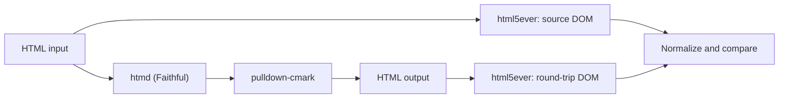

HTMD Round-Trip Testing and Fuzzing Specification
=================================================

1\. Purpose
-----------

This document defines `htmd`'s regression and seeded-fuzzing strategy. The
round-trip guarantee is limited to section 2's scope.

2\. Scope and Guarantee
-----------------------

The guarantee applies only to:

* HTML-namespace elements
* body-fragment inputs
* `Faithful` mode
* constructs not listed in the known-loss allowlist

Everything else is out of scope, not a passing case.

3\. Testing objectives and failure classes
------------------------------------------

The suite enforces four properties:

1. Panic and crash safety
2. Deterministic output
3. Exact snapshot behavior for predefined inputs
4. Round-trip preservation of supported semantics

Each result is assigned exactly one category:

| Category                | Meaning                                         | Result         |
| ----------------------- | ----------------------------------------------- | -------------- |
| Expected Error          | Error is documented and expected                | Pass           |
| Unexpected Error        | Error not in the expected-error list            | Fail           |
| Panic                   | Caught with `catch_unwind`                      | Fail           |
| Timeout                 | Worker exceeds wall-clock limit                 | Fail           |
| Resource Limit          | Worker exceeds memory limit                     | Fail           |
| Non-determinism         | Same input, different output across runs        | Fail           |
| Out of Scope            | Generated input introduced a non-HTML namespace | Fail (harness) |
| Round-Trip Mismatch     | Normalized DOMs differ without allowlist match  | Fail           |
| Known Loss              | Difference matches allowlist entry              | Pass, recorded |
| Stale Allowlist Entry   | Allowlist no longer matches real cases          | Warning        |
| Isolation Setup Failure | Resource-isolation self-test fails              | Abort          |

`Out of Scope` reports a generator defect, not a conversion defect: section 6
requires generated input to stay in the HTML namespace, so `htmd` could not be
at fault. Count it separately from conversion failures.

The expected-error list starts empty. Add a case only with a documented reason
for expecting `htmd` to return `Err` and a predefined test asserting it.
Generated valid HTML is not expected to fail.

4\. Round-trip oracle
---------------------

Compare parsed, normalized DOMs, not raw strings: attribute order, entity
spelling, void-tag formatting, and parser-added wrappers may differ despite
equivalent semantics.

Pipeline:



Steps:

1. Parse `HTML_in` as a body fragment with `html5ever`.
2. Convert the raw HTML with `htmd`.
3. Parse the Markdown with `pulldown-cmark` using the selected profile.
4. Parse the generated HTML with `html5ever` in the same mode.
5. Normalize and compare both DOMs.

Only body-fragment children are compared; generated `html`, `head`, and `body`
wrappers are ignored.

5\. Markdown parser profiles
----------------------------

`pulldown-cmark` is pinned to the version in `Cargo.lock`, and every failure
includes the exact version.

| Profile | Options                                       | Input type                                            |
| ------- | --------------------------------------------- | ----------------------------------------------------- |
| `core`  | `Options::empty()`                            | Generated cases without GFM-only constructs           |
| `gfm`   | tables, strikethrough, and task lists enabled | Generated cases with at least one GFM table construct |

Tables (including captions) qualify generated round-trip cases as GFM-only.
`htmd` does not translate task-list syntax: an HTML checkbox input in a list
item is emitted as HTML, testing only fallback preservation. A parser-only
Markdown task-list fixture verifies the pinned `pulldown-cmark` option.

`del` and `s` have no handler in `src/element_handler/`; `Faithful` mode emits
them as raw HTML. They are not GFM-only generated constructs: tests cover HTML
preservation, not strikethrough translation. A parser-only fixture may verify
that the pinned GFM profile renders Markdown strikethrough as expected.

GitHub math is not part of GFM. Parser-only fixtures assert the exact HTML
rendered by the pinned `pulldown-cmark` math extension. Exclude math from the
round-trip equality corpus unless the oracle defines how that HTML corresponds
to source math.

A generated case belongs to exactly one profile:

* `core` generator disables GFM-only constructs
* `gfm` generator forces at least one GFM-only construct
* no case is run under both profiles

A predefined snapshot may cover GFM in `core` mode for single-pass Markdown
checks, but not round-trip equality when the parser profile cannot reproduce
those constructs.

6\. DOM model and normalization
-------------------------------

Compare normalized DOM trees.

Node kinds:

* Element: namespace, lowercase tag name, attributes, ordered children
* Text: decoded text content
* Comment: comment text
* Ignored: doctype and processing instructions

Namespace rule:

* Only HTML namespace is supported.
* Generated input must not introduce SVG, MathML, or other foreign-content
  elements.
* If a non-HTML namespace appears during generated runs, classify the case as
  `Out of Scope`.

Normalization passes run in order on both trees:

1. Collapse runs of ASCII whitespace inside non-opaque text nodes to a single
   space.
2. Trim spaces around `br` boundaries.
3. Collapse spaces across adjacent inline text leaves.
4. Trim leading and trailing whitespace at inline-run edges.
5. In each `li`, represent every maximal direct run of inline-content children
   as one canonical paragraph. A direct `p` child with inline-content children
   has the same canonical representation. This makes bare list-item content
   equivalent to the paragraph wrapper `pulldown-cmark` adds for loose lists;
   separate `p` children and other block children remain distinct and ordered.
6. Remove empty text nodes and merge adjacent text siblings.

Compare opaque elements exactly, without normalizing internal whitespace. `pre`
and `textarea` are always opaque. `code` is opaque only when `preformatted_code`
is enabled. Section 8 inherits `preformatted_code: false` from
`Options::default()`, which does not preserve whitespace inside inline `<code>`;
unconditional opacity would report specified behavior as a mismatch.

Block vs. inline:

* Block elements are `address`, `article`, `aside`, `blockquote`, `body`,
  `caption`, `center`, `dd`, `details`, `dialog`, `dir`, `div`, `dl`, `dt`,
  `fieldset`, `figcaption`, `figure`, `footer`, `form`, `h1`–`h6`, `head`,
  `header`, `hgroup`, `hr`, `html`, `legend`, `li`, `main`, `menu`, `nav`, `ol`,
  `p`, `pre`, `search`, `section`, `summary`, `table`, `tbody`, `td`, `tfoot`,
  `th`, `thead`, `tr`, and `ul`.
* Inline elements include `a`, `abbr`, `b`, `bdi`, `bdo`, `br`, `button`,
  `cite`, `code`, `data`, `del`, `dfn`, `em`, `i`, `img`, `input`, `ins`, `kbd`,
  `label`, `mark`, `meter`, `output`, `progress`, `q`, `ruby`, `s`, `samp`,
  `select`, `small`, `span`, `strong`, `sub`, `sup`, `textarea`, `time`, `u`,
  and `var`. Classify other elements by their HTML content model; generated
  cases use only the listed inventory.
* Inline runs are maximal sequences of non-block children in a block container.
* For the list-item pass, inline-content children are text, comments, and inline
  elements. Group maximal direct-child runs after removing whitespace-only
  block-boundary text using the existing boundary rule.

Remove whitespace-only runs at block boundaries; preserve semantically
meaningful inline boundary spaces.

7\. Comparison rules
--------------------

* Attribute maps are compared as sets; order is irrelevant.
* All attributes are compared by default.
* Markdown-inexpressible attributes are handled only through an attribute
  exception registry.
* Core metadata must always match unless explicitly exempted: `href`, `src`,
  `alt`, `title`, `class` on `code`/`pre`, and `start` on `ol`.
* Comments and script/style nodes are compared like any other node unless
  explicitly excluded.
* Exclusions require explicit evidence and a dedicated predefined assertion.

8\. Configuration and modes
---------------------------

`Faithful` mode is the fuzzing target and aims to preserve supported round-trip
semantics; it does not promise fully lossless conversion.

`Pure` mode targets readable minimal Markdown and may discard data. Check it
with direct Markdown assertions, not round-trip equality.

Default effective options used in tests:

```rust
let options = Options {
    heading_style: HeadingStyle::Atx,
    bullet_list_marker: BulletListMarker::Asterisk,
    code_block_style: CodeBlockStyle::Fenced,
    translation_mode: TranslationMode::Faithful,
    ..Options::default()
};
```

Other fields inherit from `Options::default()` in the pinned `htmd` version. Log
all effective options with every failure.

Known-loss allowlist:

* Starts empty.
* Entries record the HTML pattern, observed diff, source, and status.
* Matches must be narrow and programmatic.
* A mismatch fails unless it matches an allowlist rule.

9\. Predefined tests
--------------------

Run predefined tests first; compare Markdown exactly. Use existing unit and
integration tests as the regression corpus, adding snapshots only for uncovered
required behaviors. Maintain an inventory mapping each requirement to its
assertion, and verify expected output against the pinned implementation.

10\. Execution order and seeds
------------------------------

Execution order:

1. Predefined tests
2. Seeded valid-HTML fuzzing (`core`, then `gfm`)
3. Seeded malformed-HTML fuzzing

Default CI seed plan:

* Master seeds: `1, 2, 3, 42, 20260301`
* 1,000 cases per class/profile per seed
* 15,000 total CI cases for the default plan
* Scheduled runs may use a fresh entropy-derived seed, logged and stored with
  every artifact
* Parser-only math and strikethrough fixtures are additional predefined checks,
  not part of the fuzz-case total

Run each generated case with:

* panic guard via `catch_unwind`
* wall-clock timeout (default 5s)
* memory limit (default 512 MiB)
* determinism check by converting the same case twice

11\. Input generation
---------------------

Byte-level mutation does not test `htmd`. `html5ever` recovers arbitrary bytes
into a tree shaped by parsing rules rather than the input, so such a run
compares two recoveries and reaches element handlers only by accident.

Instead, the generator builds and serializes a node tree. Every `valid` case is
well formed by construction: tags balance, nesting follows each content model,
and parsing reconstructs the intended tree.

### 11.1 Case derivation

A case is deterministically identified by (master seed, case index):

* Use `rand_chacha::ChaCha8Rng`, pinned in `Cargo.lock`. The algorithm is
  required; replacing it invalidates every stored seed.
* Derive each case seed as `master_seed.wrapping_add(case_index as u64)` and
  initialize its PRNG with `SeedableRng::seed_from_u64`. Use it in sequence for
  all draws and retries.
* Record the generator version in every failure artifact. Increment it when
  changing the grammar, element tiers, or content domains below. Stored input is
  the definitive replay path; seed replay is valid only within one version.

### 11.2 Element tiers

Derive the inventory from tag registrations in `src/element_handler/mod.rs`,
grouped by translation or fallback path, not module. Generate these
body-fragment elements:

| Tier                      | Registered tags or structures                               | Coverage                                          |
| ------------------------- | ----------------------------------------------------------- | ------------------------------------------------- |
| Block translations        | `blockquote`, `ul`, `ol`, `li`, `h1`–`h6`, `hr`, `p`, `pre` | Every tag at least once per seed in both profiles |
| Inline translations       | `a`, `img`, `code`, `strong`, `b`, `i`, `em`, `br`, `span`  | Every tag at least once per seed in both profiles |
| GFM table handlers        | `table`, `td`, `th`, `tr`, `thead`, `tbody`, `caption`      | Every tag at least once per seed in `gfm`         |
| Generic block fallback    | `div`, `section`                                            | At least once per tag and seed in both profiles   |
| Unhandled inline fallback | `q`, `input`                                                | At least once per tag and seed in both profiles   |
| GFM table fallback        | A `table` containing `tfoot`                                | At least once per seed in `gfm`                   |

`div` and `section` use the generic block fallback and serialize as HTML in
`Faithful` mode. `q` and `input` use the inline HTML fallback; `q` has inline
children and `input` is void. `tfoot` has no tag-specific registration; inside a
table, the table handler falls back to HTML in `Faithful` mode because GFM
cannot preserve a distinct footer.

Do not generate registered `html`, `head`, or `body` handlers: the generator
builds body fragments, not document shells. Draw elements only where their
content models allow: block children for block containers and fallbacks, inline
children for block leaves and inline elements, table parts only under `table`,
and `li` only under `ul` or `ol`.

Profile membership follows section 5. The `core` generator draws no table tier
and no GFM-only construct; the `gfm` generator forces at least one.

### 11.3 Grammar and content models

Generate body fragments with 1–8 top-level block children; the synthetic root is
exempt from section 11.4's per-node child limit. Choose permitted elements and
child counts uniformly from applicable choices, subject to per-seed coverage and
the depth limit.

The `core` profile can generate paragraphs, headings, lists, blockquotes,
thematic breaks, code blocks, inline emphasis, code spans, links, images, hard
line breaks, and HTML fallback elements. The `gfm` profile additionally
generates tables, table captions, and task-list checkboxes. `del` and `s` may
appear as HTML fallback probes but do not count toward the GFM-construct
requirement. This inventory covers all registered handlers and explicit fallback
probes; generate no unlisted elements.

Apply these content-model rules:

* `blockquote`, `div`, and `section` contain block children.
* `ul` and `ol` contain only `li` children. A list item contains inline children
  and may also contain nested lists or other block children.
* `p` and `h1`–`h6` contain inline children only.
* `pre` contains text or a `code` child; a `code` span contains text children
  only and is never nested.
* `a`, `strong`, `b`, `i`, `em`, `span`, and `q` contain inline children.
  Anchors are not nested.
* `img`, `br`, `hr`, and `input` are void elements and have no children.
* A table contains only its permitted caption, section, row, and cell
  descendants. A task-list checkbox is an `input type="checkbox"` child of a
  list item in the `gfm` profile.
* All generated elements have matching closing tags unless they are HTML void
  elements. The serializer emits void elements without closing tags.

Links require `href`; images require `src` and may have `alt`. Section 11.5
defines valid values. Generate cases missing required attributes only as
explicit fallback probes, not valid link or image coverage.

### 11.4 Bounds

Fix and log for every run:

* maximum tree depth, default 6; root elements have depth 1
* maximum children per node, default 4
* maximum text length per node, default 64 characters

The depth bound is required because blockquote and list nesting is unbounded in
the grammar and list translation depends on depth.

### 11.5 Attribute domain

Attributes are part of the grammar. In `Faithful` mode, attributes a Markdown
construct cannot preserve select HTML serialization. For every eligible tag,
generate attributed and unattributed forms at least once per seed. Do not assume
an attribute is interchangeable across elements.

Generate no attributes or one of the following:

* Global attributes: `id`, `class`, or `title`.
* Element-specific attributes: `href` on `a`; `src` and `alt` on `img`;
  `colspan` on `td`/`th`; `start` on `ol`; and `type="checkbox"` on `input`.
* Empty-value cases only for attributes that permit empty values, such as
  `class`, `title`, and `alt`.

Use valid deterministic values: `https://example.test/...` or relative paths for
`href` and `src`; non-empty plain text for `alt`, `title`, `id`, and `class`;
positive decimal integers 1–4 for `colspan` and `start`. Escape quotes and
ampersands per HTML attribute syntax. Explicitly classify additional attribute
edge cases; do not count them as valid hyperlink or image coverage.

### 11.6 Text domain

Text pool version 1 has equally likely classes; choose one complete value from
the selected class for each text node without trimming. Use the same pool for
both profiles; GFM-specific coverage comes from their generated structures.
Classes and representative values:

* Plain words and mixed words: `Hello`, `abc123`, and
  `abcdefghijklmnopqrstuvwxyz012345`.
* Markdown-active characters: `*literal*`, `_text_`, `` `code` ``, `#`, `[`,
  `]`, `<`, `>`, `|`, and `\`.
* Apparent block starts: `- item`, `+ item`, `> quote`, `1. item`, `* item`,
  `---`, `- - -`, `***`, and `___`.
* Apparent inline constructs: `[label](https://example.test/)`,
  ``, `<span>raw</span>`, and `~~deleted~~`.
* GFM and extension markers: `| cell |`, `- [ ] task`, `$x^2$`, and `$$x^2$$`.
* Character references: `&amp;`, `&#10;`, and `&nbsp;`.
* Whitespace: empty text, a single space, multiple spaces, tabs, newlines,
  leading and trailing spaces, and mixed runs such as `two  spaces`.
* Unicode: `Привет`, punctuation adjacent to emphasis delimiters, combining
  marks, and characters outside the basic multilingual plane, which
  `src/util/unicode.rs` and `src/util/unicode_punctuation.rs` classify when
  deciding flanking and escaping.

These are text-node values, not markup. Escape literal `&`, `<`, and `>` exactly
once as `&amp;`, `&lt;`, and `&gt;`; do not escape serializer delimiters or
minify HTML, which can change tested whitespace. Emit deterministic markup
without separator whitespace between adjacent nodes.

Reject and retry a candidate whose serialized fragment exceeds 4096 UTF-8 bytes;
never truncate it. Allow at most 100 candidates per requested case. If none
fits, abort the generation run and report a generator failure separately from
converter results. Discarded candidates do not count toward the requested case
count.

### 11.7 Generator self-tests

Before serialization, validate permitted elements, parent-child relationships,
counts, depth, and text values; parser acceptance alone cannot prove validity
because HTML parsers can repair malformed markup.

Required self-tests verify:

* Valid and invalid tree fixtures are accepted and rejected correctly.
* The depth limit accepts depth 6 and rejects depth 7.
* The byte limit accepts 4096 bytes and rejects 4097 bytes.
* Text escaping occurs exactly once and serialization emits the expected tags.
* An oversized candidate is retried without truncation.
* Exhausting 100 candidates reports a generator failure.
* Two runs of 100 cases with seed 0, identical versions, and identical
  configuration produce byte-identical ordered inputs.

Use controlled candidate fixtures for retry and exhaustion tests. Generator
failures must not be reported as `htmd` conversion defects.

### 11.8 The malformed class

The `malformed` class tests parser recovery and crash safety, not round-trip
preservation of the recovered tree. Corrupt a generated valid tree's serialized
form once by dropping a closing tag, closing tags out of order, or truncating
mid-tag. A well-formed element without a tag-specific handler is not corruption.

Assert panic and crash safety, determinism, timeout, and memory limit for each
`malformed` case. Do not compare it against a round trip or assign a Markdown
parser profile: `html5ever`'s recovered tree differs from the generated tree.

Well-formed HTML-fallback probes from section 11.2 belong to `valid` and use the
normal round-trip oracle. This tests faithful serialization of elements such as
`section` and `input` separately from malformed-input recovery.

### 11.9 Case counts

The default CI plan runs these three class/profile combinations, making section
10's total auditable:

| Combination | Class       | Profile | Cases per seed |
| ----------- | ----------- | ------- | -------------- |
| 1           | `valid`     | `core`  | 1,000          |
| 2           | `valid`     | `gfm`   | 1,000          |
| 3           | `malformed` | none    | 1,000          |

Five master seeds across three combinations yield 15,000 cases.

12\. Worker model and resource limits
-------------------------------------

Run fuzzing in worker subprocesses; ordinary panic handling cannot catch
infinite loops or OOM aborts.

The parent process:

* sends a case to the worker
* waits for the result
* kills the worker if it exceeds the timeout or memory limit
* records the failure as `Timeout` or `Resource Limit`

Memory enforcement depends on platform:

* Linux with cgroups: hard limit via `memory.max`
* Linux without cgroups: `RLIMIT_AS` plus polling `/proc/<pid>/status`
* Windows: Job Object memory limit
* macOS/other: resident-size polling only (soft limit)

Before fuzzing, use test-only commands on the same worker executable to verify
both worker-kill paths:

* `spin` performs no conversion and loops until terminated. Run it with the
  normal timeout and a generous memory limit. Pass only if the parent observes
  the timeout, terminates the worker, and records timeout termination, not a
  normal exit.
* `allocate N` retains an `N`-MiB buffer and writes at least one byte per page
  to commit memory. Run it with a self-test limit below `N` and a generous
  timeout. Pass only if memory enforcement terminates the worker before normal
  exit. If an address-space limit makes allocation fail inside the worker, it
  must exit with a reserved non-success status that the parent recognizes as
  resource-limit termination, not a successful run.

Choose limits and allocation size so baseline worker memory fits below the limit
and the allocation exceeds it substantially. Test-only commands are unavailable
during ordinary fuzzing. Abort with `Isolation Setup Failure` if either check
fails.

13\. Failure artifacts and minimization
---------------------------------------

Write a JSON artifact for each failure with:

* master seed and case index
* input class and parser profile
* original HTML source
* effective options
* versions of `htmd`, `html5ever`, `pulldown-cmark`, and `rand_chacha`
* generated Markdown and round-trip HTML
* normalized DOMs and the first differing path
* failure category and allowlist match, if any
* active memory-limit mode and limits

Failure reduction flow:

1. Reproduce from the stored input.

2. Reduce the tree by removing nodes, hoisting children, and shortening text or
   attributes.

3. Keep reductions that preserve the failure category.

4. Save the minimal reproducer as a regression test.

5. Triage:

   * oracle bug -> fix normalization and add a self-test
   * intentional loss -> add allowlist entry
   * conversion defect -> fix `htmd` and update design docs

14\. Limitations
----------------

* Random generation cannot cover every structure.
* Preservation checks only supported semantics, HTML-namespace content, and the
  active parser profile.
* Registry entries must be narrow and evidence-backed.
* Memory-limit claims are valid only on platforms with real enforcement.

15\. Conclusion
---------------

This spec combines exact snapshots, a seeded replayable round-trip fuzzer, and
an explicit oracle to distinguish:

* real conversion bugs
* parser/normalization effects
* intentional known losses

Together, they provide a focused, strict validation strategy for `htmd`.
