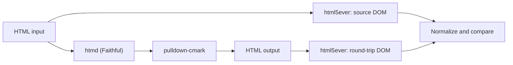

HTMD Round-Trip Testing and Fuzzing Specification
=================================================

1\. Purpose
-----------

This document defines `htmd` regression and seeded fuzzing. The round-trip
guarantee is limited to section 2.

2\. Scope and Guarantee
-----------------------

The round-trip guarantee applies only to:

* HTML-namespace elements
* body-fragment inputs
* `Faithful` mode
* constructs not listed in the known-loss allowlist

Everything else is out of scope and must not be treated as a passing case.

3\. Testing objectives and failure classes
------------------------------------------

The suite enforces four properties:

1. Panic and crash safety
2. Deterministic output
3. Exact snapshot behavior for predefined inputs
4. Round-trip preservation of supported semantics

Each result is assigned exactly one category:

| Category                | Meaning                                         | Result         |
| ----------------------- | ----------------------------------------------- | -------------- |
| Expected Error          | Error is documented and expected                | Pass           |
| Unexpected Error        | Error not in the expected-error list            | Fail           |
| Panic                   | Caught with `catch_unwind`                      | Fail           |
| Timeout                 | Worker exceeds wall-clock limit                 | Fail           |
| Resource Limit          | Worker exceeds memory limit                     | Fail           |
| Non-determinism         | Same input, different output across runs        | Fail           |
| Out of Scope            | Generated input introduced a non-HTML namespace | Fail (harness) |
| Round-Trip Mismatch     | Normalized DOMs differ without allowlist match  | Fail           |
| Known Loss              | Difference matches allowlist entry              | Pass, recorded |
| Stale Allowlist Entry   | Allowlist no longer matches real cases          | Warning        |
| Isolation Setup Failure | Resource-isolation self-test fails              | Abort          |

`Out of Scope` indicates a generator defect: section 6 requires
HTML-namespace input. This category is a guard against generator regressions;
a conforming `core` or `gfm` generator never produces it. Count it separately
from conversion failures.

Expected-error list: starts empty. Add a case only with a documented reason to
expect `htmd` to return `Err` and a predefined test asserting it. Generated
valid HTML is not expected to fail. At the reviewed revision,
`HtmlToMarkdown::html_to_tree` parses an in-memory UTF-8 `&str` with `.one()`
and returns `Ok`; `convert` wraps the resulting Markdown in `Ok`. No ordinary
I/O error kind is expected from this built-in path, even for malformed HTML
(the parser repairs it). The `io::Result` signature alone does not imply an
expected error. Panics and worker/resource failures retain their own categories;
reassess this list if the conversion API or implementation changes.

4\. Round-trip oracle
---------------------

Raw string comparison is invalid because attribute order, entity spelling,
void-tag formatting, and parser-added wrappers can differ despite equivalent
semantics.

The oracle compares parsed, normalized DOMs.

Pipeline:



Steps:

1. Parse `HTML_in` as a **document**, using `html5ever::parse_document`,
   `RcDom`, and the same `ParseOpts` as `HtmlToMarkdown::html_to_tree` in
   `src/lib.rs`. Use `TreeBuilderOpts { scripting_enabled: true,
   ..Default::default() }` and otherwise default parse options, matching the
   converter used by this suite. The generator produces body content, but this
   does not mean the parser uses `parse_fragment`.
2. Convert the identical, unmodified `HTML_in` with `htmd` in `Faithful` mode.
3. Parse the generated Markdown with `pulldown-cmark` using the selected
   profile and render it to HTML.
4. Parse that HTML as a document with the exact same options as step 1.
5. Extract the ordered children of the HTML-namespace `body` element from each
   document, then normalize and compare them. Do not compare either document
   directly with the generator's pre-serialization tree.

Ignore document wrappers and `head` content when extracting body children;
never find `body` by matching a tag in a foreign namespace. Failure to find a
body is an oracle setup error, not an empty passing tree. A generator validation
failure is separate from a converter mismatch. Retain the original input in
artifacts, including whitespace and character-reference spelling.

The public `HtmlToMarkdown::html_to_tree` method may be reused for both parse
steps to prevent parser-option drift. `tests/common/fuzzer_support.rs` supplies
this body-extraction helper. `tests/fuzzer_contract_tests.rs` checks it against
explicit document parsing for leading whitespace, stray table parts, initial
`pre` newlines, character references, and raw-content elements. These are parser
contract tests; malformed fixtures do not acquire a round-trip guarantee.

5\. Markdown parser profiles
----------------------------

Pin `pulldown-cmark` to the version in `Cargo.lock`; include the exact version
in every failure.

| Profile | Options                                       | Input type                                            |
| ------- | --------------------------------------------- | ----------------------------------------------------- |
| `core`  | `Options::empty()`                            | Generated cases without GFM-only constructs           |
| `gfm`   | tables, strikethrough, and task lists enabled | Generated cases with at least one GFM table construct |

Tables (including captions) qualify generated round-trip cases as GFM-only.
`htmd` does not translate task-list syntax: an HTML checkbox input in a list
item is emitted as HTML and tests only fallback preservation. A parser-only
Markdown task-list fixture verifies the pinned `pulldown-cmark` option.

`del` and `s` lack handlers in `src/element_handler/`, so `Faithful` mode emits
them as raw HTML. They are not GFM-only generated constructs: tests cover HTML
preservation, not strikethrough translation. A parser-only fixture may verify
that the pinned GFM profile renders Markdown strikethrough.

GitHub math is not GFM. Parser-only fixtures assert the exact HTML rendered by
the pinned `pulldown-cmark` math extension. Exclude math from round-trip
equality unless the oracle defines how rendered HTML corresponds to source math.

A generated case belongs to exactly one profile:

* `core` generator disables GFM-only constructs
* `gfm` generator forces at least one GFM-only construct
* no case is run under both profiles

A predefined snapshot may check GFM under `core` for single-pass Markdown, but
cannot assert round-trip equality if that parser profile cannot reproduce the
constructs.

6\. DOM model and normalization
-------------------------------

Compare normalized DOM trees.

Node kinds:

* Element: namespace, lowercase tag name, attributes, ordered children
* Text: decoded text content
* Comment: comment text
* Ignored: doctype and processing instructions

Namespace rule:

* Only HTML namespace is supported.
* Generated input must not introduce SVG, MathML, or other foreign-content
  elements.
* If a non-HTML namespace appears during generated runs, classify the case as
  `Out of Scope`.

Normalization passes run in order on both trees:

1. Collapse runs of ASCII whitespace inside non-opaque text nodes to a single
   space.
2. Trim spaces around `br` boundaries.
3. Collapse spaces across adjacent inline text leaves.
4. Trim leading and trailing whitespace at inline-run edges.
5. In each `li`, represent every maximal direct run of inline-content children
   as one canonical paragraph. A direct `p` child with inline-content children
   has the same canonical representation. This makes bare list-item content
   equivalent to the paragraph wrapper `pulldown-cmark` adds for loose lists;
   separate `p` children and other block children remain distinct and ordered.
6. Remove empty text nodes and merge adjacent text siblings.

Compare opaque elements exactly, without normalizing internal whitespace.
`pre` and `textarea` are always opaque; `code` is opaque only when
`preformatted_code` is enabled. Section 8 inherits `preformatted_code: false`
from `Options::default()`, so inline `<code>` whitespace is not preserved;
treating `code` as always opaque would report specified behavior as a mismatch.

Block vs. inline:

* Use exactly `BLOCK_ELEMENTS` in `src/util/node.rs` for block membership;
  every other HTML element is inline for this split. This is htmd's CommonMark
  serialization classification, not CSS display or the HTML content-model
  classification. Content-model validation remains a separate generator check.
* The set is private to the library. An external harness must maintain a
  versioned copy with an executable equality check against that source set;
  updating the pinned htmd revision requires rechecking it. Do not substitute
  an open-ended tag list or infer membership from handler names. In particular,
  `textarea` is in the block set and is also opaque under the rule above.
* Inline runs are maximal sequences of non-block children within a block
  container
* For the list-item pass above, inline-content children are text, comments, and
  inline elements. Form maximal runs of these direct children; whitespace-only
  block-boundary text is removed by the existing boundary rule before those runs
  are formed.

Remove whitespace-only runs at block boundaries; preserve semantically
meaningful inline boundary spaces.

7\. Comparison rules
--------------------

* Attribute maps are compared as sets; order is irrelevant.
* All attributes are compared by default.
* Markdown-inexpressible attributes are handled only through an attribute
  exception registry.
* Core metadata must always match unless explicitly exempted: `href`, `src`,
  `alt`, `title`, `class` on `code`/`pre`, and `start` on `ol`.
* Comments and script/style nodes are compared like any other node unless
  explicitly excluded.
* Exclusions require explicit evidence and a dedicated predefined assertion.

8\. Configuration and modes
---------------------------

`Faithful` mode is the fuzzing target and aims to preserve supported round-trip
semantics; it does not promise fully lossless conversion.

`Pure` mode produces readable minimal Markdown and may discard data; check it
with direct Markdown assertions, not round-trip equality.

Default effective options used in tests:

```rust
let options = Options {
    heading_style: HeadingStyle::Atx,
    bullet_list_marker: BulletListMarker::Asterisk,
    code_block_style: CodeBlockStyle::Fenced,
    translation_mode: TranslationMode::Faithful,
    ..Options::default()
};
```

The explicit heading, bullet, and code-block styles equal `Options::default()`
at the pinned revision; only `translation_mode` overrides its default (`Pure`).
Other fields inherit from `Options::default()` at the pinned `htmd` version.
Log all effective options with every failure.

Known-loss allowlist:

* Starts empty
* Each entry records the HTML pattern, observed diff, source, and status
* Matches must be narrow and programmatic
* A mismatch is a failure unless it matches an allowlist rule

9\. Predefined tests
--------------------

Run predefined tests first and compare Markdown exactly. Use existing unit and
integration tests as the regression corpus; add snapshots only for uncovered
required behaviors. Maintain an inventory mapping each requirement to its
assertion, and verify expected output against the pinned implementation. New
Markdown snapshots must be executable integration tests under `tests/`, using
the conversion helpers in `tests/common/mod.rs` (Faithful by default). Reuse
existing assertions instead of duplicating a snapshot table or test suite.
`cargo test` must execute these assertions; a prose statement that output was
checked is insufficient. Parser/PRNG contract tests need not assert Markdown.

10\. Execution order and seeds
------------------------------

Execution order:

1. Predefined tests
2. Seeded valid-HTML fuzzing (`core`, then `gfm`)
3. Seeded malformed-HTML fuzzing

Default CI seed plan:

* Master seeds: `1, 2, 3, 42, 20260301`
* 1,000 cases per class/profile per seed
* 15,000 total CI cases for the default plan
* Scheduled runs may use a fresh entropy-derived seed, logged and stored with
  every artifact together with the generator version, text-pool version,
  exact PRNG dependency versions, and effective generator configuration
* Parser-only math and strikethrough fixtures are additional predefined checks,
  not part of the fuzz-case total

Each generated case is run with:

* panic guard via `catch_unwind`
* wall-clock timeout (default 5s)
* memory limit (default 512 MiB)
* determinism check by converting the same case twice

11\. Input generation
---------------------

Byte-level mutation does not test `htmd`: `html5ever` error recovery determines
the tree shape from arbitrary bytes. Such a run compares two recovered trees
and reaches element handlers only by accident.

Instead, build and serialize a node tree. Every `valid` case is well formed:
tags balance, nesting follows each element's content model, and parsing
reconstructs the intended tree.

### 11.1 Case derivation

A case is identified by (generator version, configuration, class/profile,
master seed, case index). This revision uses generator version 2 and text-pool
version 2; seeds from previous drafts are not compatible.

The project adds exact development dependencies `rand = "=0.9.2"` and
`rand_chacha = "=0.9.0"` in `Cargo.toml` and commits their resolved `Cargo.lock`.
Use `rand::SeedableRng` and `rand_chacha::ChaCha8Rng`; they are test/harness
dependencies, not library runtime dependencies.

Case derivation:

* Use `rand_chacha::ChaCha8Rng`, pinned in `Cargo.lock`. The algorithm is
  required; a similarly named custom PRNG is not a substitute.
* Set each case seed to `master_seed.wrapping_add(case_index as u64)` and
  initialize its PRNG with `SeedableRng::seed_from_u64`. Use this PRNG in
  sequence for all case draws, including retries. Create a fresh PRNG for each
  requested case. For uniform bounded choices, use `rand::Rng::random_range`
  on `u32` bounds and cast the result to `usize`; this avoids target-width
  differences and modulo bias. Repeated generation increments the case index
  with wrapping arithmetic and reseeds from the resulting pair.
* Record the generator version in every failure artifact. Increment it when
  changing the grammar, element tiers, content domains, draw order, bounded
  sampling method, or either PRNG dependency version. Such changes invalidate
  seed-only replay across versions; retain old versions for historical replay.
  Record both `rand` and `rand_chacha` versions, even for a patch upgrade. Stored input is
  the definitive replay path; seed replay is valid only within one version.

### 11.2 Element tiers

The inventory groups the body-fragment tag registrations in
`src/element_handler/mod.rs` by translation or fallback path, not module:

| Tier                      | Registered tags or structures                               | Coverage                                          |
| ------------------------- | ----------------------------------------------------------- | ------------------------------------------------- |
| Block translations        | `blockquote`, `ul`, `ol`, `li`, `h1`–`h6`, `hr`, `p`, `pre` | Every tag at least once per seed in both profiles |
| Inline translations       | `a`, `img`, `code`, `strong`, `b`, `i`, `em`, `br`, `span`  | Every tag at least once per seed in both profiles |
| GFM table handlers        | `table`, `td`, `th`, `tr`, `thead`, `tbody`, `caption`      | Every tag at least once per seed in `gfm`         |
| Generic block fallback    | `div`, `section`                                            | At least once per tag and seed in both profiles   |
| Unhandled inline fallback | `q`, `input`                                                | At least once per tag and seed in both profiles   |
| GFM table fallback        | A `table` containing `tfoot`                                | At least once per seed in `gfm`                   |

`div` and `section` use the generic block fallback and serialize as HTML in
`Faithful` mode; `q` and `input` use the inline HTML fallback (`q` has inline
children; `input` is void). None has tag-specific registration. `tfoot` also
lacks registration; inside a table, the handler falls back to HTML in
`Faithful` mode because GFM cannot preserve a distinct footer.

Do not generate registered `html`, `head`, or `body` handlers: the generator
builds body fragments, not document shells. Draw elements only where their
content models allow: block children for block containers/fallbacks, inline
children for block leaves/inline elements, table parts only under `table`, and
`li` only under `ul` or `ol`.

Profile membership follows section 5. The `core` generator draws no table tier
and no GFM-only construct; the `gfm` generator forces at least one.

### 11.3 Grammar and content models

Generate body fragments with 1–8 top-level block children; the synthetic root
is exempt from section 11.4's child limit. Choose permitted elements and child
counts uniformly from applicable choices, subject to per-seed coverage and the
depth limit.

The `core` profile can generate paragraphs, headings, lists, blockquotes,
thematic breaks, code blocks, inline emphasis, code spans, links, images, hard
line breaks, and HTML fallback elements. The `gfm` profile additionally
generates tables, table captions, and task-list checkboxes. `del` and `s` may
appear as HTML fallback probes but do not count toward the GFM-construct
requirement. The inventory is complete for the registered handlers and explicit
fallback probes in this section; no unlisted element is generated.

Apply these content-model rules:

* `blockquote`, `div`, and `section` contain block children.
* `ul` and `ol` contain only `li` children. A list item contains inline children
  and may also contain nested lists or other block children.
* `p` and `h1`–`h6` contain inline children only.
* `pre` contains text or a `code` child; a `code` span contains text children
  only and is never nested.
* `a`, `strong`, `b`, `i`, `em`, `span`, and `q` contain inline children.
  Anchors are not nested.
* `img`, `br`, `hr`, and `input` are void elements and have no children.
* A table contains only its permitted caption, section, row, and cell
  descendants. A task-list checkbox is an `input type="checkbox"` child of a
  list item in the `gfm` profile.
* All generated elements have matching closing tags unless they are HTML void
  elements. The serializer emits void elements without closing tags.

Require `href` for hyperlinks and `src` for images; images may also have `alt`.
Section 11.5 defines valid values. Generate cases missing required attributes
only as explicit fallback probes, not as valid link or image coverage.

### 11.4 Bounds

Every run fixes and logs:

* maximum tree depth, default 6; root elements have depth 1
* maximum children per node, default 4
* maximum text length per node, default 64 Unicode scalar values (`text.chars().count()`
  in Rust), counted before HTML escaping; combining marks count separately and
  a non-BMP scalar counts once. This is neither a grapheme count nor a byte
  count. The serialized fragment has a separate 4096-byte UTF-8 limit

The depth bound is required because blockquote and list nesting is unbounded and
list translation depends on depth.

### 11.5 Attribute domain

Attributes are part of the grammar. In `Faithful` mode, attributes a Markdown
construct cannot preserve select HTML serialization. For every eligible tag,
exercise attributed and unattributed forms at least once per seed. Attributes
are not interchangeable across elements.

Generate no attributes or one of the following:

* Global attributes: `id`, `class`, or `title`.
* Element-specific attributes: `href` on `a`; `src` and `alt` on `img`;
  `colspan` on `td`/`th`; `start` on `ol`; and `type="checkbox"` on `input`.
* Empty-value cases only for attributes that permit empty values, such as
  `class`, `title`, and `alt`.

Use valid, deterministic values: `https://example.test/...` or relative paths
for `href` and `src`; non-empty plain text for `alt`, `title`, `id`, and
`class`; and positive decimal integers within 1–4 for `colspan` and `start`.
Escape quotes and ampersands according to HTML attribute syntax. Additional
attribute edge cases must be explicitly classified and must not be used to claim
valid hyperlink or image coverage.

### 11.6 Text domain

Text pool version 2 has equally likely classes. For each text node, choose one
complete, untrimmed value from a class. Both profiles use this pool; GFM coverage
comes from that profile's generated structures. Classes and representative
values:

* Plain words and mixed words: `Hello`, `abc123`, and
  `abcdefghijklmnopqrstuvwxyz012345`.
* Markdown-active characters: `*literal*`, `_text_`, `` `code` ``, `#`, `[`,
  `]`, `<`, `>`, `|`, and `\`.
* Apparent block starts: `- item`, `+ item`, `> quote`, `1. item`, `* item`,
  `---`, `- - -`, `***`, and `___`.
* Apparent inline constructs: `[label](https://example.test/)`,
  ``, `<span>raw</span>`, and `~~deleted~~`.
* GFM and extension markers: `| cell |`, `- [ ] task`, `$x^2$`, and `$$x^2$$`.
* Decoded character-reference values: `&` (U+0026), newline (U+000A),
  and non-breaking space (U+00A0). Store the decoded scalars in text nodes,
  not the strings `&amp;`, `&#10;`, or `&nbsp;`.
* Whitespace: empty text, a single space, multiple spaces, tabs, newlines,
  leading and trailing spaces, and mixed runs such as `two  spaces`.
* Unicode: `Привет`, punctuation adjacent to emphasis delimiters, combining
  marks, and characters outside the basic multilingual plane, which
  `src/util/unicode.rs` and `src/util/unicode_punctuation.rs` classify when
  deciding flanking and escaping.

These are text values, not markup. Escape literal `&`, `<`, and `>` exactly once
as `&amp;`, `&lt;`, and `&gt;`, but do not escape serializer markup delimiters.
Thus U+0026 serializes as `&amp;`, U+000A as a literal newline, and U+00A0
as a literal UTF-8 non-breaking space. Raw reference spellings are covered by
separate parser fixtures, outside the random text pool. If a fixture deliberately
stores the literal text `&#10;`, it must serialize as `&amp;#10;` and parse back
to those five literal characters, not a newline.
Do not minify HTML, which could change tested whitespace. Emit deterministic
markup without separator whitespace between adjacent nodes.

Reject and retry fragments exceeding 4096 UTF-8 bytes; never truncate them.
Allow at most 100 candidates per requested case. If none fits, abort generation
and report a generator failure separately from converter results. Discarded
candidates do not count toward the requested case count.

### 11.7 Generator self-tests

Before serialization, validate permitted elements, parent-child relationships,
counts, depth, and text values; parser acceptance alone is insufficient because
parsers can repair malformed markup.

Required self-tests verify:

* Valid and invalid tree fixtures are accepted and rejected correctly.
* The depth limit accepts depth 6 and rejects depth 7.
* The byte limit accepts 4096 bytes and rejects 4097 bytes.
* Text escaping occurs exactly once and serialization emits the expected tags.
* An oversized candidate is retried without truncation.
* Exhausting 100 candidates reports a generator failure.
* Two runs of 100 cases with seed 0, identical versions, and identical
  configuration produce byte-identical ordered inputs.

Use controlled candidate fixtures for retry and exhaustion. Do not report
generator failures as `htmd` conversion defects.

### 11.8 The malformed class

The `malformed` class tests parser recovery and crash safety, not round-trip
preservation. Corrupt a generated valid tree's serialization once by dropping a
closing tag, closing tags out of order, or truncating mid-tag. A well-formed
element without a tag-specific handler is not corruption.

Assert panic/crash safety, determinism, timeout, and memory limit for each
`malformed` case. Do not compare it against a round trip or assign a Markdown
profile: `html5ever`'s recovered tree differs from the generated tree.

Well-formed HTML-fallback probes (section 11.2) belong to `valid` and use the
normal round-trip oracle. This tests faithful serialization of elements such as
`section` and `input` separately from malformed-input recovery.

### 11.9 Case counts

The default CI plan runs these three class/profile combinations (section 10):

| Combination | Class       | Profile | Cases per seed |
| ----------- | ----------- | ------- | -------------- |
| 1           | `valid`     | `core`  | 1,000          |
| 2           | `valid`     | `gfm`   | 1,000          |
| 3           | `malformed` | none    | 1,000          |

Five master seeds across three combinations yield 15,000 cases.

12\. Worker model and resource limits
-------------------------------------

Use worker subprocesses because ordinary panic handling cannot catch infinite
loops or OOM aborts.

The parent process:

* sends a case to the worker
* waits for the result
* kills the worker if it exceeds the timeout or memory limit
* records the failure as `Timeout` or `Resource Limit`

Memory enforcement depends on platform:

* Linux with cgroups: hard limit via `memory.max`
* Linux without cgroups: `RLIMIT_AS` plus polling `/proc/<pid>/status`
* Windows: Job Object memory limit
* macOS/other: resident-size polling only (soft limit)

Before fuzzing, self-test both worker-kill modes with test-only commands on the
same worker executable:

* `spin` loops without conversion until terminated. Run it with the normal
  timeout and a generous memory limit. Pass only if the parent observes a
  timeout, terminates the worker, and records timeout rather than normal exit.
* `allocate N` retains an `N`-MiB buffer and writes to at least one byte per
  page to commit memory. Use a self-test memory limit below `N` and a generous
  timeout. Pass only if enforcement terminates the worker before normal exit.
  If an address-space limit makes allocation fail inside the worker, it must
  exit with a reserved non-success status that the parent recognizes as an
  expected resource-limit termination, not a successful run.

Choose limits so baseline memory fits below the limit and allocation exceeds it
substantially. Disable test-only commands during ordinary fuzzing. Abort with
`Isolation Setup Failure` if either check fails.

13\. Failure artifacts and minimization
---------------------------------------

Each failure writes a JSON artifact containing:

* master seed and case index
* input class and parser profile
* original HTML source
* effective options
* generator version, text-pool version, and complete generator configuration
* versions of `htmd`, `html5ever`, `pulldown-cmark`, `rand`, and `rand_chacha`
* htmd source commit and lockfile identity used for the run
* generated Markdown and round-trip HTML
* normalized DOMs and the first differing path
* failure category and allowlist match, if any
* active memory-limit mode and limits

Reduce failures as follows:

1. Reproduce the failure from the stored input.

2. Reduce the tree by removing nodes, hoisting children, and shortening
   text/attributes.

3. Keep only reductions that preserve the same failure category, input
   class/profile, content-model validity (for valid inputs), and the failing
   element's translate-or-serialize decision in the pinned `Faithful` handlers.
   Track the failing element and its relevant ancestors through each edit;
   reject candidates that remove that element or change its path selection.
   For example, removing an extra attribute can turn a serialized anchor into
   translated Markdown, while shortening `href`, `src`, `start`, `colspan`, or
   a language class can leave its valid domain. Such reductions are rejected
   even when they still produce `Round-Trip Mismatch`. Revalidate attributes
   and recompute decisions using the actual handler predicates, including
   ancestor-sensitive table/pre fallback. If the harness cannot establish
   unchanged decisions, conservatively reject that reduction. Preserve both
   original and reduced inputs with their recorded decisions in the artifact.

4. Save the minimal reproducer as a regression test.

5. Triage:

   * oracle bug -> fix normalization and add a self-test
   * intentional loss -> add allowlist entry
   * conversion defect -> fix `htmd` and update design docs

14\. Limitations
----------------

* Random generation cannot cover every structure.
* The preservation check is only for supported semantics, HTML-namespace
  content, and the active parser profile.
* Registry entries must stay narrow and evidence-backed.
* Memory-limit claims are valid only on platforms with real enforcement.

15\. Conclusion
---------------

This spec combines exact snapshots, a seeded replayable round-trip fuzzer, and
an explicit oracle to distinguish:

* real conversion bugs
* parser/normalization effects
* intentional known losses

Together, they provide focused, strict validation for `htmd`.
